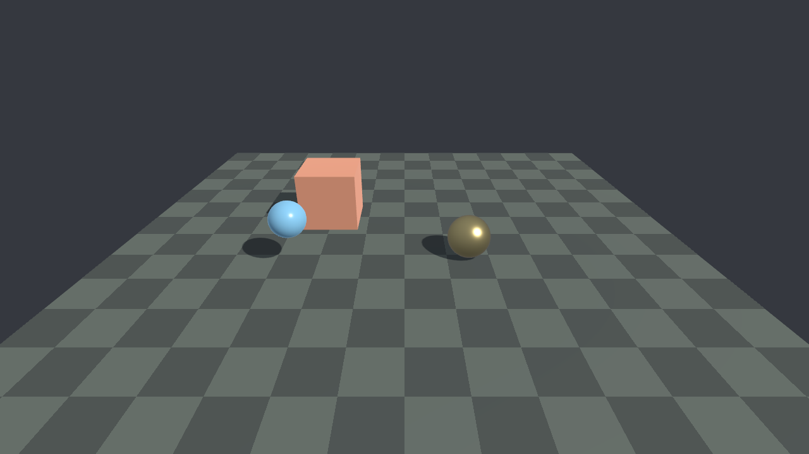

<p align="center">
  
</p>

<h1 align="center">Bayleaf Engine</h1>

<p align="center">
  <a href="docs/releasing.md"></a>
  <a href="docs/vision.md"></a>
  
  <a href="#license"></a>
</p>

<p align="center"><strong>A game engine and editor written in Rust, where every action is a command that people, scripts and AI agents share.</strong></p>

<p align="center">
  <a href="#build-from-source">Build from source</a> ·
  <a href="docs/vision.md">Roadmap</a> ·
  <a href="#documentation">Documentation</a> ·
  <a href="docs/releasing.md">Versions</a>
</p>

<p align="center">
  <a href="docs/images/demo-scene.png"></a>
</p>

Bayleaf Engine is a native editor, a player and a headless CLI built on one engine. Scenes are
objects with components on an archetype ECS, games are scripted in sandboxed WebAssembly or
with node graphs, and everything the editor can do is a registered command. That makes the same
features available from the menus, the CLI and AI agents over MCP. Anything above the core is
opt-in: physics, sound, gameplay roles and world streaming are cargo features that small projects
can leave out.

## Features

Every feature below works both in the editor and through commands.

### Editor

| Feature | What it does |
|---|---|
| **Docked panels**<br>Hierarchy, Scene, Game, Inspector, Project, Console, Graph | Panels you can resize, rearrange and maximise; layouts are saved between runs. |
| **Projects and prefabs**<br>`.bproject`, `.bscene`, `.bprefab` | Projects in plain folders, scenes as readable JSON, and prefabs whose copies keep their own changes. |
| **Play mode**<br>Play, Pause, Step | Runs the game inside the editor and puts the scene back when it stops. Scripts reload while it plays. |
| **Accessible and translatable**<br>keyboard, screen readers, languages | Controls are reachable by keyboard and named for assistive technology; UI tests check both. The interface goes through craft-i18n (Window > Language). |
| **Undo everywhere**<br>whole-scene snapshots | Edits, drags and graph changes undo and redo as single steps. |

### Scripts and graphs

| Feature | What it does |
|---|---|
| **WebAssembly scripts**<br>Rust SDK, hot reload | Game code runs sandboxed, with limits on fuel and memory, and reloads when the file changes. See [the script ABI](docs/script-abi.md). |
| **Visual scripts**<br>`.bscript` | Node graphs that compile to the same WebAssembly ABI. They support variables, text, whole numbers, object search and components. |
| **Material graphs**<br>compiled to WGSL | Surface materials built from nodes, with a live preview. See [graphs](docs/graphs.md). |

### Runtime modules

| Feature | What it does |
|---|---|
| **Rendering**<br>wgpu | Lights, shadows, sky, models and sprites. Positions are double precision, so large worlds don't jitter. |
| **Physics** (`physics`)<br>Rapier | Rigid bodies, colliders, characters, joints with motors, raycasts. Precision can be single or double. |
| **Sound** (`audio`)<br>craft-audio, cpal | Audio Sources heard from the camera, plus sounds that scripts play at a position. |
| **Gameplay** (`gameplay`)<br>opt-in roles | Input Maps, player control, game rules and saved values. |
| **World streaming** (`streaming`)<br>Streamed Areas | Parts of the world load in the background as the camera nears them; one command splits a scene into grid cells. |

### Automation

| Feature | What it does |
|---|---|
| **Commands**<br>`bayleaf-cli run`, `batch` | Every editor action can run headless, one at a time or as a batch. |
| **AI agents**<br>`bayleaf-cli mcp` | An MCP server whose tools are the commands. Agents can only read and write inside the folders you allow. See [automation](docs/automation.md). |
| **Live editor control**<br>`--control` | Agents can also drive an open editor, which shows when they can. |

## Build from source

You need Rust 1.95 or newer. To build the example scripts, you also need the WebAssembly target:

```sh
rustup target add wasm32-unknown-unknown
cargo xtask scripts                                     # build the example scripts (once)
```

Then run the editor, the player or the CLI:

```sh
cargo run -p bayleaf -- examples/demo/demo.bscene       # editor with the demo; Play, then WASD and Space
cargo run -p bayleaf -- path/to/Game.bproject           # editor with a project (File > New Project makes one)
cargo run -p bayleaf-player -- path/to/Game.bproject    # the game in its own window (F11: full screen)
cargo run -p bayleaf-cli -- commands                    # every command, as JSON
```

Two optional build inputs come from sibling Craft repositories:

- `CRAFT_FONTS_DIR` (a craft-fonts checkout) embeds the interface faces.
- `CRAFT_I18N_DIR` (a craft-i18n checkout) embeds the translations.

Without them the editor uses egui's fonts and English.

## AI agents

`bayleaf-cli mcp` runs headless, or drives an open editor started with `--control`. It refuses to
start until you name the folders it may read and write:

```sh
cargo run -p bayleaf-cli -- mcp --automation-read-root examples --automation-write-root out
```

Setup for Claude Code and the editor bridge is in [docs/automation.md](docs/automation.md).

## Documentation

- [Vision and roadmap](docs/vision.md): decisions, layers and milestones
- [Automation](docs/automation.md): commands, the CLI, MCP and confinement
- [Graphs](docs/graphs.md): material graphs and visual scripts
- [Script ABI](docs/script-abi.md): what WebAssembly scripts can call
- [Branches and versions](docs/releasing.md): how `main`, `develop` and releases work
- [Rules for contributors and agents](AGENTS.md)
- [Feature names](docs/feature-names.md) and [asset attribution](ATTRIBUTION.md)

## Versions

`main` holds released versions, each tagged `vX.Y.Z` by Semantic Versioning. Work happens on
`develop`. The current version is **0.1.0**. See [docs/releasing.md](docs/releasing.md).

## License

Bayleaf Engine is dual-licensed under the [MIT License](LICENSE-MIT) or the
[Apache License 2.0](LICENSE-APACHE), at your option. Third-party notices are in [NOTICE](NOTICE).
