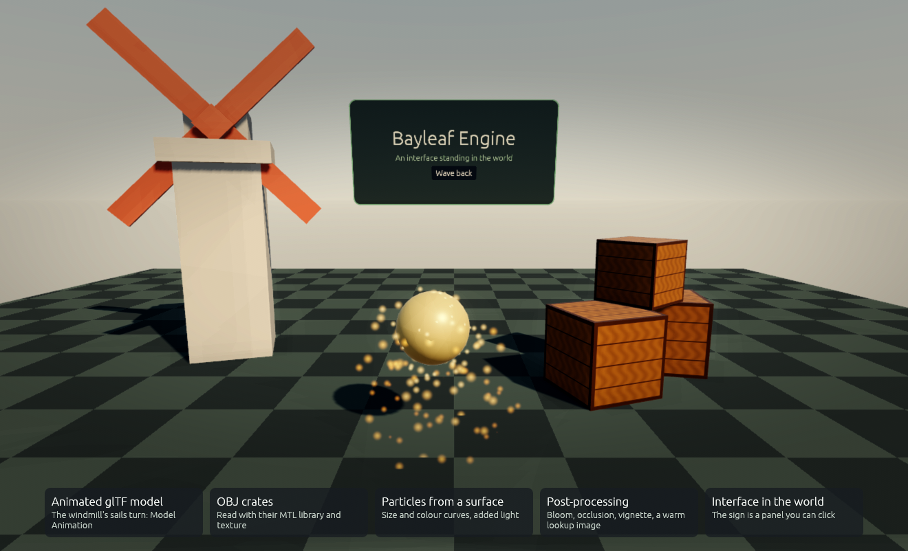
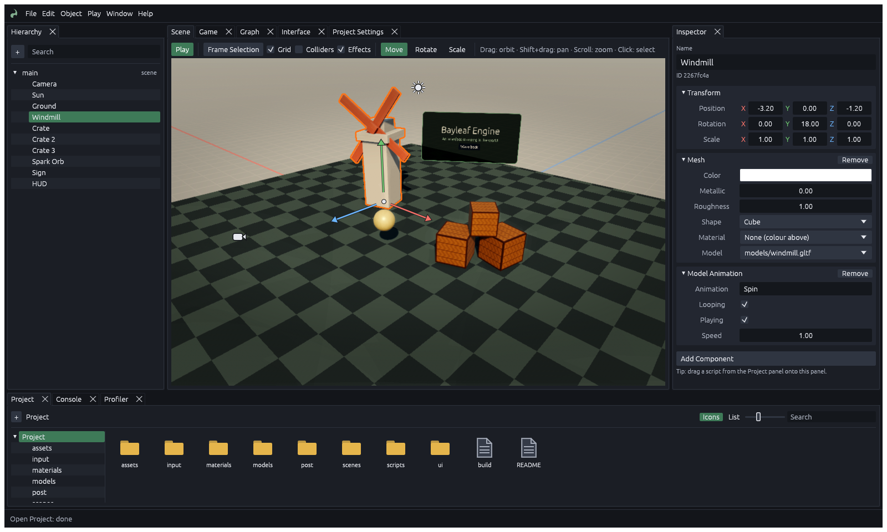
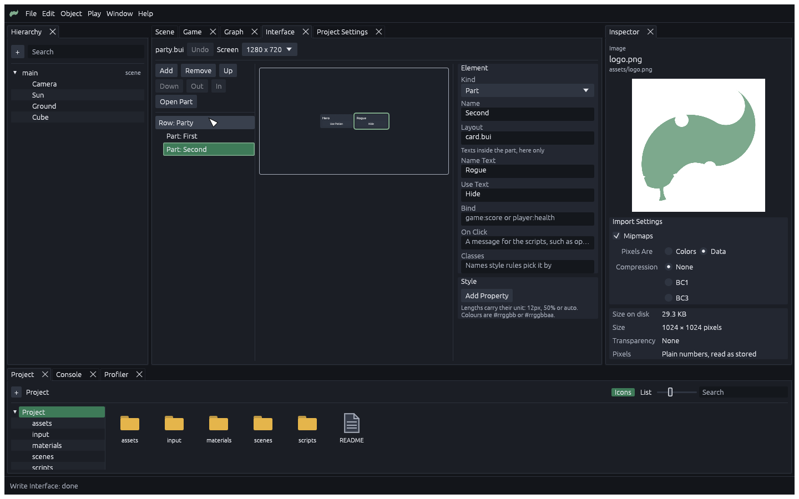

<p align="center">
  
</p>

<h1 align="center">Bayleaf Engine</h1>

<p align="center">
  <a href="docs/releasing.md"></a>
  <a href="docs/vision.md"></a>
  
  <a href="#license"></a>
</p>

<p align="center"><strong>A game engine and editor written in Rust, where every action is a command that people, scripts and AI agents share.</strong></p>

<p align="center">
  <a href="#showcase">Showcase</a> ·
  <a href="#build-from-source">Build from source</a> ·
  <a href="docs/vision.md">Roadmap</a> ·
  <a href="#documentation">Documentation</a> ·
  <a href="docs/releasing.md">Versions</a>
</p>

<p align="center">
  <a href="docs/images/showcase-game.png"></a>
</p>

Bayleaf Engine is a native editor, a player and a headless CLI built on one engine. Scenes are
objects with components on an archetype ECS, games are scripted in sandboxed WebAssembly or
with node graphs, and everything the editor can do is a registered command. That makes the same
features available from the menus, the CLI and AI agents over MCP. Anything above the core is
opt-in: physics, sound, gameplay roles and world streaming are cargo features that small projects
can leave out.

## Showcase

[`examples/showcase`](examples/showcase) is a project that shows what the engine can do now. It is
built entirely by commands: [`build.json`](examples/showcase/build.json) is the `bayleaf-cli batch`
recipe that wrote its interfaces, its post-processing and its objects.

- **An animated glTF model:** the windmill's sails turn, played by its Model Animation component.
- **OBJ models:** the crates are read with their MTL library and texture.
- **Particles from a surface:** sparks start on the sphere's surface, with size and colour curves
  and added light.
- **Post-processing:** tone mapping, bloom, ambient occlusion, a vignette and a warm colour lookup image.
- **Interfaces:** the sign is an interface standing in the world that the pointer can click, and
  the cards along the bottom are one part used five times, each use with its own texts.

<p align="center">
  <a href="docs/images/showcase-editor.png"></a>
</p>

<p align="center">
  <a href="docs/images/interface-panel.png"></a>
</p>

```sh
cargo run -p bayleaf -- examples/showcase/Showcase.bproject   # open it, then Play (Ctrl+P)
```

## Features

Every feature below works both in the editor and through commands.

### Editor

| Feature | What it does |
|---|---|
| **Docked panels**<br>Hierarchy, Scene, Game, Inspector, Project, Console, Graph, Interface, Profiler | Panels you can resize, rearrange and maximise; layouts are saved between runs. Graphs open in tabs of their own, side by side. |
| **Projects and prefabs**<br>`.bproject`, `.bscene`, `.bprefab` | Projects in plain folders, scenes as readable JSON, and prefabs whose copies keep their own changes. |
| **Bringing files in**<br>drag and drop | Files dropped on the editor are copied in and placed: glTF and OBJ models, PNG, JPEG and OpenEXR images, WAV, Ogg Vorbis, FLAC, MP3 and other sounds. Each keeps import settings beside it (scale and axes; mipmaps, colour or data, BC1 or BC3 compression; streaming). |
| **Play mode**<br>Play, Pause, Step | Runs the game inside the editor and puts the scene back when it stops. Scripts reload while it plays. |
| **Profiler**<br>CPU and GPU | Each frame's time by part (scripts, physics, sound, particles, drawing) and the GPU's own time, as a graph to pause on. |
| **Accessible and translatable**<br>keyboard, screen readers, languages | Controls are reachable by keyboard and named for assistive technology, interfaces in the world included; UI tests check both. The interface goes through craft-i18n (Window > Language). |
| **Undo everywhere**<br>whole-scene snapshots | Edits, drags and graph changes undo and redo as single steps. |

### Scripts and graphs

| Feature | What it does |
|---|---|
| **WebAssembly scripts**<br>Rust SDK, hot reload | Game code runs sandboxed, with limits on fuel and memory, and reloads when the file changes. See [the script ABI](docs/script-abi.md). |
| **Visual scripts**<br>`.bscript` | Node graphs that compile to the same WebAssembly ABI: variables, text, numbers, object search, components, interfaces and particles. |
| **Material graphs**<br>compiled to WGSL | Surface materials built from nodes, with a live preview. See [graphs](docs/graphs.md). |

### Runtime

| Feature | What it does |
|---|---|
| **Rendering**<br>wgpu | Lights, shadows, sky, models and sprites. Positions are double precision, so large worlds don't jitter. |
| **Post-processing**<br>`.bpost` | Tone mapping, bloom, colour adjustment with a lookup image, vignette, depth fog, ambient occlusion and antialiasing, per scene or per camera. |
| **Model animation**<br>glTF nodes and skins | A model's animations play by name, looping or held at the end, at any speed. |
| **Particles**<br>Particle Emitter | Sprites or meshes from a point, shape or a mesh's surface, with size and colour curves. |
| **Game interfaces**<br>`.bui`, `.bstyle` | Layouts of panels, text, buttons, toggles, sliders, fields and lists, with style files and reusable parts; on the screen or standing in the world, driven by gamepad, keyboard or pointer. See [interfaces](docs/interface.md). |
| **Physics** (`physics`)<br>Rapier | Rigid bodies, colliders, characters, joints with motors, raycasts. Precision can be single or double. |
| **Sound** (`audio`)<br>craft-audio, cpal | Audio Sources heard from the camera, sounds that scripts play at a position, and long music read from its file as it plays. |
| **Gameplay** (`gameplay`)<br>opt-in roles | Input Maps, player control, game rules and saved values. |
| **World streaming** (`streaming`)<br>Streamed Areas | Parts of the world load in the background as the camera nears them; one command splits a scene into grid cells. |

### Automation

| Feature | What it does |
|---|---|
| **Commands**<br>`bayleaf-cli run`, `batch` | Every editor action can run headless, one at a time or as a batch. |
| **AI agents**<br>`bayleaf-cli mcp` | An MCP server whose tools are the commands. Agents can only read and write inside the folders you allow. See [automation](docs/automation.md). |
| **Live editor control**<br>`--control` | Agents can also drive an open editor, which shows when they can. |

## Build from source

You need Rust 1.95 or newer. To build the example scripts, you also need the WebAssembly target:

```sh
rustup target add wasm32-unknown-unknown
cargo xtask scripts                                     # build the example scripts (once)
```

Then run the editor, the player or the CLI:

```sh
cargo run -p bayleaf -- examples/showcase/Showcase.bproject   # editor with the showcase
cargo run -p bayleaf -- examples/demo/demo.bscene       # editor with the first demo; Play, then WASD and Space
cargo run -p bayleaf-player -- path/to/Game.bproject    # the game in its own window (F11: full screen)
cargo run -p bayleaf-cli -- commands                    # every command, as JSON
```

File > Export Game in the editor (or `project.export`) writes a project as a game folder: the
player program under the game's name and its files beside it. Build the player first
(`cargo build --release -p bayleaf-player` for a smaller, faster game).

Two optional build inputs come from sibling Craft repositories:

- `CRAFT_FONTS_DIR` (a craft-fonts checkout) embeds the interface faces.
- `CRAFT_I18N_DIR` (a craft-i18n checkout) embeds the translations.

Without them the editor uses egui's fonts and English.

## AI agents

`bayleaf-cli mcp` runs headless, or drives an open editor started with `--control`. It refuses to
start until you name the folders it may read and write:

```sh
cargo run -p bayleaf-cli -- mcp --automation-read-root examples --automation-write-root out
```

Setup for Claude Code and the editor bridge is in [docs/automation.md](docs/automation.md).

## Documentation

- [Vision and roadmap](docs/vision.md): decisions, layers and milestones
- [Automation](docs/automation.md): commands, the CLI, MCP and confinement
- [Interfaces](docs/interface.md): layouts, styles, parts and interfaces in the world
- [Graphs](docs/graphs.md): material graphs and visual scripts
- [Script ABI](docs/script-abi.md): what WebAssembly scripts can call
- [Branches and versions](docs/releasing.md): how `main`, `develop` and releases work
- [Rules for contributors and agents](AGENTS.md)
- [Feature names](docs/feature-names.md) and [asset attribution](ATTRIBUTION.md)

## Versions

`main` holds released versions, each tagged `vX.Y.Z` by Semantic Versioning. Work happens on
`develop`. The current version is **0.2.0**. See [docs/releasing.md](docs/releasing.md).

## License

Bayleaf Engine is dual-licensed under the [MIT License](LICENSE-MIT) or the
[Apache License 2.0](LICENSE-APACHE), at your option. Third-party notices are in [NOTICE](NOTICE).
